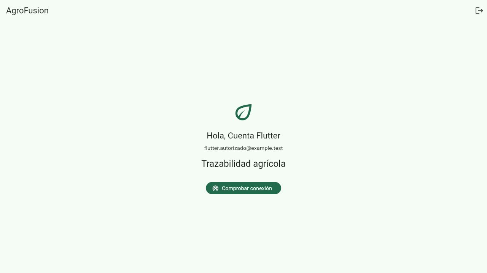
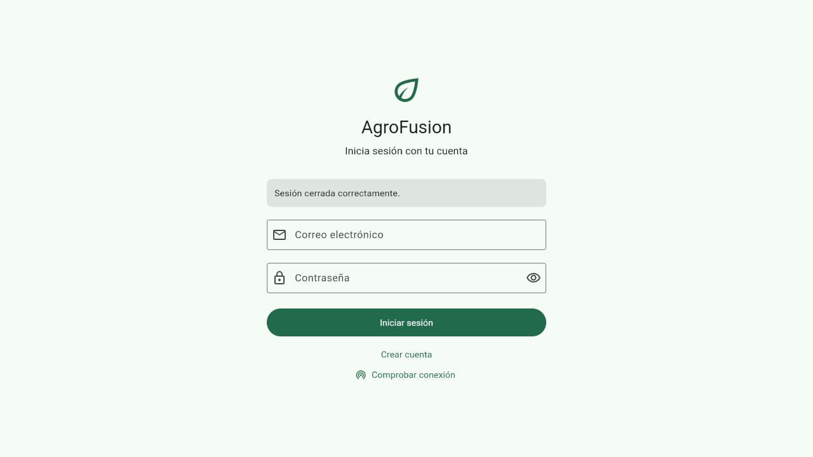
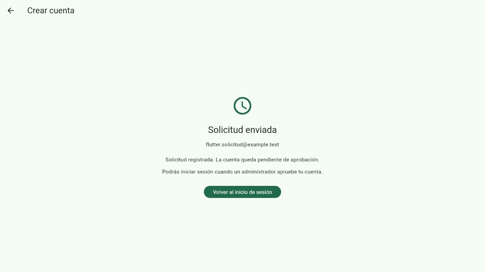
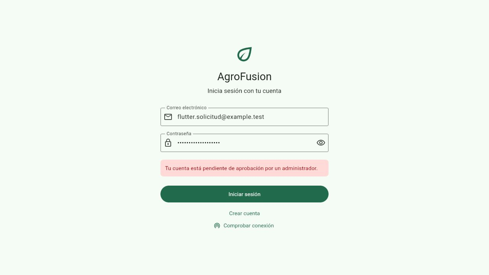
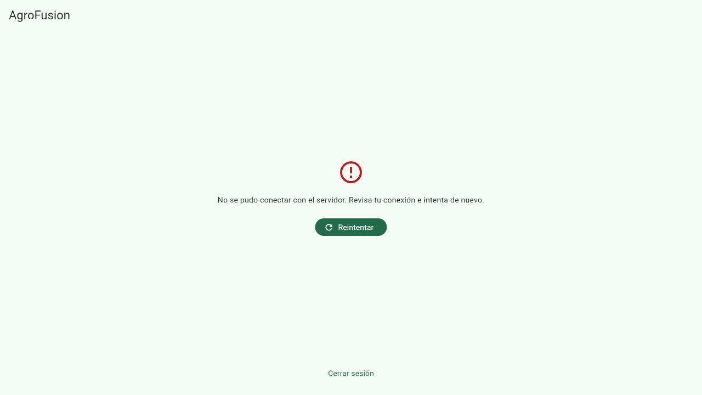

# Verificar la autenticación con Laravel

Esta guía permite al equipo reproducir la verificación de la issue #4,
**[EDT 1.3] Migrar autenticación de React Native a Flutter**. Incluye el
flujo real de Flutter web contra Laravel y los resultados de las pruebas
automatizadas de acceso, registro, cierre y restauración de sesión.

## Entorno y resultados

La comprobación se realizó el **26 de octubre de 2026**, en Windows con
PowerShell, Flutter 3.44.5, Dart 3.12.2, PHP 8.3.33 y Laravel 12.40.2.
El navegador integrado ejecutó la compilación web de Flutter en
`http://127.0.0.1:5174`, conectada a `http://127.0.0.1:8008/api`.

| Comprobación | Resultado |
| --- | --- |
| Formato Dart | 32 archivos comprobados; ninguno requiere cambios. |
| `flutter analyze --no-pub` | Sin problemas. |
| `flutter test --no-pub` | 105 pruebas aprobadas. |
| Compilación web con la URL de pruebas | Correcta. |
| Suite completa de Laravel | 382 pruebas aprobadas, 1 omitida y 4359 aserciones. |
| Preparador del entorno | Crea una base aislada y rechaza sobrescribir un perfil existente. |

La prueba Laravel omitida es
`ReporteCentroFiltrosRealDbTest::test_reportes_con_filtros_en_bd_real`:
requiere una base SQLite persistente y se omite con `:memory:`. Las pruebas
de la API y las regresiones web de la suite sí se ejecutaron.

## Preparar los datos de prueba

Necesitas las dependencias de `Mobile/` y `Web/` instaladas y PHP con
`pdo_sqlite`. Laravel debe estar sin caché de configuración:
`Web/bootstrap/cache/config.php` no debe existir. El preparador se detiene
si detecta esa caché o un archivo `.env.authcheck` existente.

Desde la raíz del repositorio, ejecuta:

```powershell
cd Web
php scripts/preparar-auth-flutter.php
```

El script crea una base SQLite vacía dentro de un directorio temporal con
nombre aleatorio, ejecuta las migraciones y carga los roles y permisos.
Genera `.env.authcheck` con su ruta y una clave de aplicación aleatoria.
El entorno `authcheck` mantiene separado el arranque habitual de `local`.
La base habitual y el archivo `.env` no se modifican.

La cuenta ficticia aprobada tiene estos datos:

| Campo | Valor de prueba |
| --- | --- |
| Nombre | Cuenta Flutter |
| Correo | `flutter.autorizado@example.test` |
| Contraseña | `Flutter-Prueba-2026` |
| Rol | `agricultor` |
| Estado | Activa y aprobada. |

Estas credenciales pertenecen exclusivamente a la base de verificación.
El correo usa el dominio reservado `.test`. El perfil utiliza correo y
caché `array`; no envía mensajes a destinatarios externos.

Si `.env.authcheck` ya existe y corresponde a esta prueba, reutiliza el
perfil desde el siguiente paso. El script termina con código 1 y conserva
su contenido al ejecutarlo otra vez. Si la base temporal ya no existe,
retira únicamente ese perfil de prueba antes de preparar otro; conserva
el `.env` habitual. El archivo `.env.authcheck` queda excluido de Git y la
base se guarda fuera del repositorio.

## Ejecutar Laravel y Flutter

1. Desde `Web/`, inicia Laravel con el perfil preparado:

   ```powershell
   php artisan serve --env=authcheck --host=127.0.0.1 --port=8008 --no-reload
   ```

2. Abre otra terminal en la raíz del repositorio. Compila Flutter y sirve
   el resultado:

   ```powershell
   cd Mobile
   flutter build web --no-pub --dart-define=API_BASE_URL=http://127.0.0.1:8008/api
   php -S 127.0.0.1:5174 -t build/web
   ```

3. Abre `http://127.0.0.1:5174` en el navegador. Mantén ambas terminales
   abiertas mientras verificas el flujo. Usa siempre ese mismo origen
   para comprobar la persistencia del almacenamiento web.

El indicador `--no-reload` conserva el entorno configurado al servir Laravel.
La URL de API se incorpora a la compilación de Flutter; vuelve a compilar
si cambias de servidor. Los archivos de `build/web/` están excluidos de Git.

## Repetir los casos reales

Los siguientes casos se ejecutaron desde la interfaz de Flutter. Laravel
procesó las peticiones y persistió los datos en la base aislada.

| Paso | Acción | Resultado observado |
| --- | --- | --- |
| 1 | Inicia sesión con la cuenta aprobada. | Aparece **Hola, Cuenta Flutter** después de obtener el token y verificar `GET /api/me`. |
| 2 | Recarga la página con esa sesión abierta. | Restaura el usuario y vuelve a mostrar el inicio sin introducir credenciales. |
| 3 | Pulsa **Cerrar sesión**. | Vuelve al login y muestra **Sesión cerrada correctamente.** |
| 4 | Recarga después del cierre. | Permanece en el login; el token eliminado no recupera el acceso. |
| 5 | Abre **Crear cuenta** y completa una solicitud con los datos de abajo. | Muestra **Solicitud enviada** y el mensaje de aprobación pendiente. |
| 6 | Vuelve al login. | Conserva el correo de la solicitud y deja la contraseña vacía. |
| 7 | Introduce la contraseña de esa cuenta pendiente e intenta entrar. | Muestra **Tu cuenta está pendiente de aprobación por un administrador.** y mantiene el login. |
| 8 | Inicia sesión otra vez con la cuenta aprobada. Detén Laravel con `Ctrl+C` y recarga Flutter. | Muestra un error de conexión con **Reintentar** y **Cerrar sesión**, sin mostrar el inicio autenticado. |
| 9 | Reinicia Laravel con el mismo comando y pulsa **Reintentar**. | Valida el token conservado y recupera el inicio autenticado. |
| 10 | Cierra la sesión para finalizar. | Vuelve al login y revoca el token de esa sesión. |

Datos usados en la solicitud: nombre `Solicitud`, apellido `Flutter`, correo
`flutter.solicitud@example.test`, nombre de usuario `flutter_solicitud` y
contraseña y confirmación `Flutter-Prueba-2026`; teléfono vacío. Para repetir
el registro en la misma base, utiliza otro correo y otro nombre de usuario:
Laravel rechaza los duplicados.

Una consulta de la base aislada confirmó que la solicitud conserva estado
`pendiente` y rol `agricultor`. Después del primer cierre y el intento de
acceso pendiente había **0 tokens activos** en `personal_access_tokens`.

### Capturas de la prueba

Las capturas contienen únicamente datos ficticios. Los resultados también
están descritos en la tabla anterior para poder revisarlos sin las imágenes.











## Ejecutar las pruebas automatizadas

Desde `Mobile/`, ejecuta:

```powershell
dart format --output=none --set-exit-if-changed lib test
flutter analyze --no-pub
flutter test --no-pub
```

Las pruebas de servicios y widgets cubren validación de respuestas, cuentas
pendientes e inactivas, errores por campo, envíos duplicados, fallos de red y
almacenamiento, expiración `401`, permisos `403`, revalidación al volver al
primer plano y respuestas antiguas que no deben borrar una sesión nueva.

Desde `Web/`, ejecuta la suite con SQLite en memoria, según `phpunit.xml`:

```powershell
php artisan test --without-tty
php vendor/bin/pint --test scripts/preparar-auth-flutter.php
```

`ApiRegistroCuentaTest` verifica los campos del registro, la asignación de
rol, la ausencia de token y el rechazo de acceso pendiente.
`ApiPerfilFlujoTest` verifica login, consulta, edición de perfil y logout con
tokens Sanctum; después del cierre rechaza el token revocado y conserva la
sesión de otro dispositivo. La suite completa también comprueba las
funcionalidades web existentes.

## Finalizar y revisar los límites

Cierra la sesión de prueba y detén ambos servidores con `Ctrl+C` en sus
terminales. Puedes conservar `.env.authcheck` y su base temporal para repetir
la comprobación; no los incluyas en un commit. Las únicas credenciales
incluidas en esta guía son las ficticias del entorno aislado.

La evidencia real corresponde a Flutter **web** en Windows. Las pruebas con
almacenamiento simulado no sustituyen la ejecución en Android o iOS ni
verifican Keychain o el almacenamiento cifrado de Android. La compilación
web emitió un aviso de fuente `CupertinoIcons` sin impedir la generación
del resultado. El perfil y la navegación por permisos de Flutter continúan
en la issue #5.
