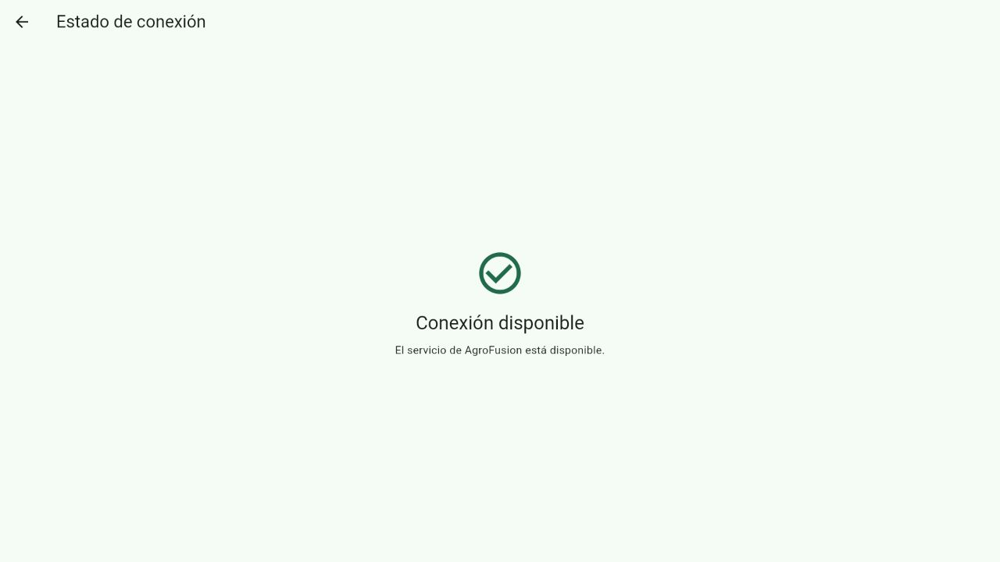
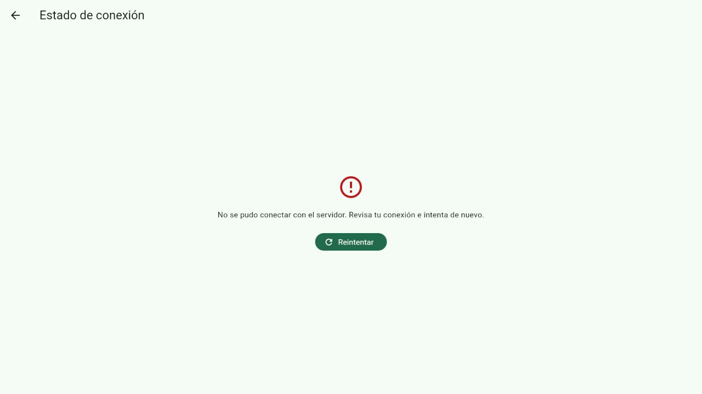

# Verificar la conexión de Flutter con Laravel

Esta guía permite al equipo reproducir la comprobación de conectividad de la
issue #3. Usa Laravel real con SQLite en memoria para consultar el endpoint
público `/api/test-api`. No prepara datos para login ni módulos operativos.

## Preparar Laravel

Necesitas PHP 8.2 o superior, Composer y las extensiones que exige
`Web/composer.json`, incluidas GD, PDO PostgreSQL y PDO SQLite. Para reproducir
esta verificación se utilizó PHP 8.3.33 con Laravel 12.40.2.

Desde la raíz del repositorio, entra al backend e instala las versiones
del archivo de bloqueo:

```powershell
cd Web
composer install --no-interaction --prefer-dist --no-progress --no-scripts
```

`--no-scripts` evita ejecutar el preparador automático de la base local. La
comprobación pública no necesita restaurar una base ni modificar usuarios.

Si `.env.mobile` no existe, copia la plantilla aislada y genera una clave:

```powershell
if (-not (Test-Path .env.mobile)) {
    Copy-Item ../Mobile/docs/laravel-connectivity.env.example .env.mobile
    php artisan package:discover --env=mobile
    php artisan key:generate --env=mobile
}
```

Si ya existe, conserva su clave y comprueba que define `APP_ENV=mobile` y
`DB_DATABASE=:memory:`. Usa este entorno exclusivamente para la comprobación
de conectividad. `.env.mobile` está excluido de Git y no se agrega al commit.

## Ejecutar Laravel

Desde `Web/`, inicia el servidor en la primera terminal:

```powershell
php artisan serve --env=mobile --host=127.0.0.1 --port=8000 --no-reload
```

Confirma que la dirección de escucha es `http://127.0.0.1:8000`. El comando del
proyecto también puede imprimir una dirección WiFi; la opción `--host`
anterior mantiene esta prueba en la interfaz local.

En otra terminal, comprueba la respuesta HTTP:

```powershell
Invoke-RestMethod http://127.0.0.1:8000/api/test-api
```

El campo `ok` debe ser `True`.

## Ejecutar Flutter

Desde la raíz del repositorio, usa una segunda terminal para abrir Flutter:

```powershell
cd Mobile
flutter run -d edge --dart-define=API_BASE_URL=http://127.0.0.1:8000/api
```

Para reproducir el flujo, sigue estos pasos:

1. Pulsa **Comprobar conexión** y confirma **Conexión disponible**.
2. Detén Laravel con `Ctrl+C` en su terminal.
3. Regresa al inicio de Flutter y pulsa otra vez **Comprobar conexión**.
4. Confirma el mensaje de error y el botón **Reintentar**.
5. Ejecuta de nuevo el comando del servidor Laravel en la primera terminal.
6. Pulsa **Reintentar** en Flutter y confirma **Conexión disponible**.
7. Regresa al inicio para comprobar el retorno de navegación.

Pulsa `q` en la terminal de Flutter y `Ctrl+C` en la de Laravel para finalizar.

## Ejecutar las pruebas del contrato HTTP

Las pruebas `ApiHealthTest` verifican el JSON público, el encabezado CORS de
respuesta y la petición preflight con encabezados JSON y Bearer.

Desde `Web/`, prepara un entorno de pruebas local si no existe:

```powershell
if (-not (Test-Path .env.testing)) {
    $testingEnv = (Get-Content -Raw .env.mobile) -replace `
        '(?m)^APP_ENV=mobile\r?$', 'APP_ENV=testing'
    Set-Content .env.testing -Value $testingEnv -Encoding utf8 -NoNewline
}
php artisan test --without-tty --filter=ApiHealthTest
```

`.env.testing` también queda excluido de Git. En esta versión de Collision,
`--without-tty` debe ser el primer argumento después de `test`.

## Consultar la evidencia

La verificación del 2026-10-25 produjo estos resultados:

| Comprobación | Resultado |
| --- | --- |
| Laravel real, `GET /api/test-api` | HTTP `200`, cuerpo `{"ok":true}`. |
| CORS desde el origen de Flutter | `Access-Control-Allow-Origin: *`, configuración existente de Laravel. |
| Flutter 3.44.5 web en navegador Chromium | Muestra **Conexión disponible** con el endpoint real. |
| Laravel detenido | Muestra un error controlado y la opción **Reintentar**. |
| Laravel reiniciado | **Reintentar** recupera la conexión. |
| Pruebas de contrato de Laravel | 2 pruebas, 10 aserciones, sin fallos ni advertencias. |
| Pruebas Flutter del bloque anterior | 21 pruebas aprobadas. |

Estas capturas corresponden a la aplicación en ejecución:





La ejecución manual se realizó con `flutter run -d web-server` en
`http://127.0.0.1:8787` y el navegador integrado de Codex. El comando de Edge
permite repetir la comprobación fuera de ese navegador.

La compilación web, el análisis estático y el formato de Dart se verificaron
en el bloque de implementación. El workflow `Flutter checks` incorpora esas
comprobaciones y las pruebas al PR; su ejecución remota debe revisarse después
de publicar la rama y abrir el PR.

## Interpretar los límites de la verificación

La conectividad comprobada corresponde al endpoint público. El login, la
autorización por permisos y el almacenamiento nativo en Android e iOS requieren
sus propias pruebas; no están demostrados por esta comprobación web.

Composer emitió avisos previos sobre un `composer.lock` desactualizado y dos
clases que incumplen PSR-4. La instalación utilizó el bloqueo existente y no
actualizó dependencias ni modificó `composer.json` o `composer.lock`.
