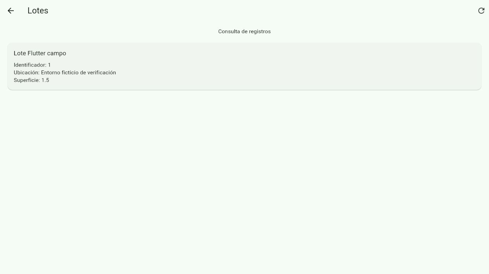
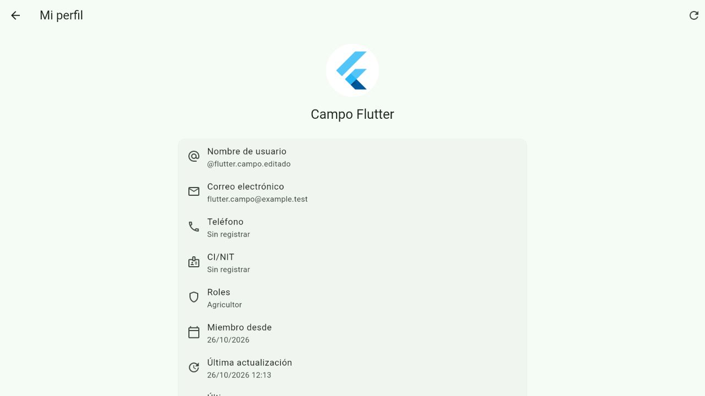
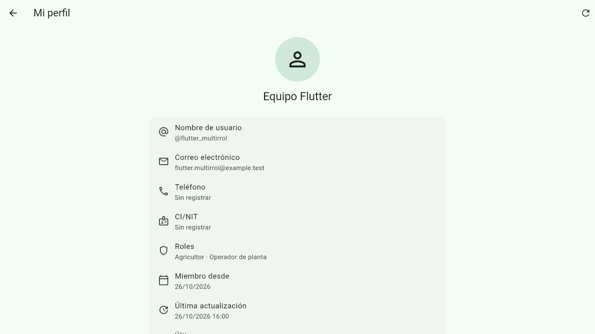
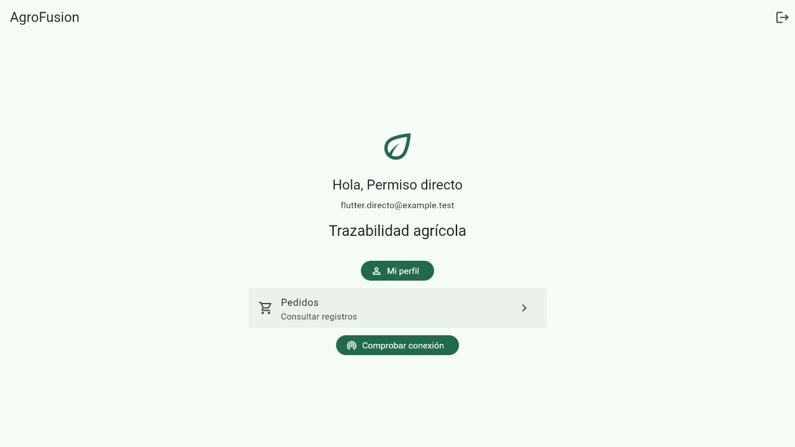
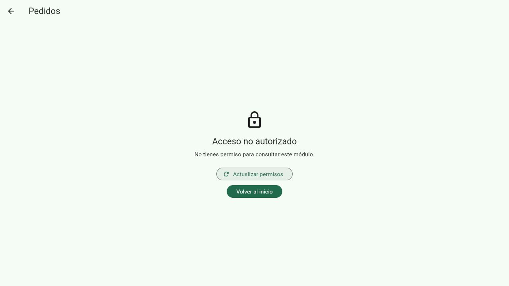
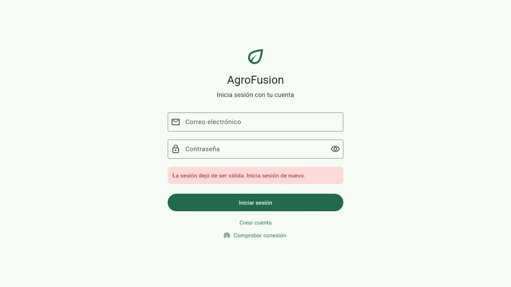
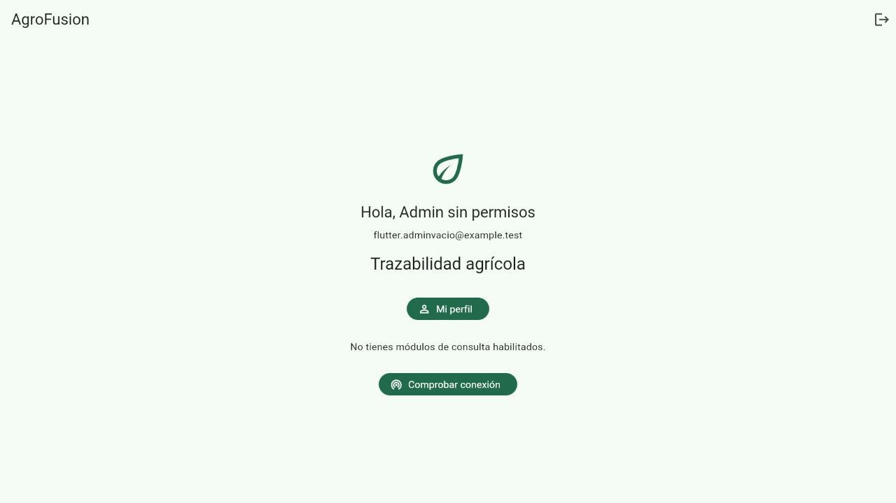
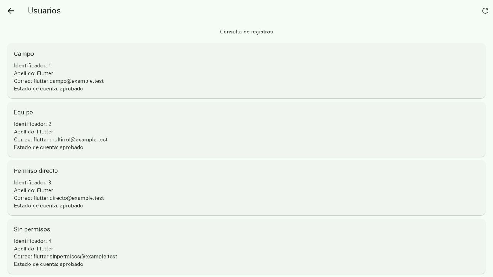
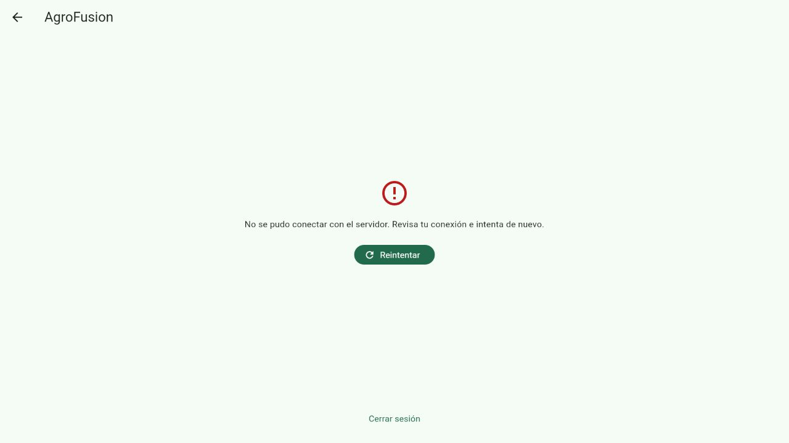

# Verificar perfil y navegación con Laravel

Esta guía permite al equipo reproducir la integración de la issue #5,
**[EDT 1.4] Migrar perfil y navegación por permisos a Flutter**. Incluye
consulta y edición del perfil propio, restauración y autorización de los
destinos de consulta. Los formularios de negocio de esos módulos tienen
su propio alcance de migración.

## Entorno y resultados

La verificación se realiza el **26 de octubre de 2026** en Windows,
con Flutter 3.44.5, Dart 3.12.2, PHP 8.3.33 y Laravel 12.40.2. Flutter web
usa `http://127.0.0.1:5175` y Laravel `http://127.0.0.1:8009/api`.

Los resultados automatizados son:

| Comprobación | Resultado |
| --- | --- |
| Formato Dart | 48 archivos, sin cambios pendientes de formato. |
| Análisis estático | Sin problemas. |
| Suite Flutter | 182 pruebas aprobadas. |
| Compilación web con la API de prueba | Correcta, con comprobación de compatibilidad Wasm. |
| Suite Laravel | 387 pruebas aprobadas, 1 omitida, 4394 aserciones. |
| Matriz HTTP real | 78 consultas de módulos: 19 respuestas `200` y 59 respuestas `403`. |
| Preparador | Crea una base separada y rechaza sobrescribir el perfil existente. |

La prueba omitida de Laravel es
`ReporteCentroFiltrosRealDbTest::test_reportes_con_filtros_en_bd_real`:
requiere SQLite persistente y se omite con `:memory:`. Las pruebas de acceso,
perfil y regresiones web se ejecutan con la base en memoria.

Las pruebas Flutter usan respuestas simuladas y almacenamiento de prueba.
Las comprobaciones de interfaz descritas en esta guía usan Laravel y SQLite
persistente reales. La evidencia cubre web; la ejecución y el almacenamiento
seguro en dispositivos Android e iOS requieren sus comprobaciones de plataforma.

## Preparar el entorno aislado

Necesitas instalar las dependencias de `Web/` y `Mobile/`, habilitar
`pdo_sqlite` y mantener Laravel sin caché de configuración. El preparador
se detiene si existe `bootstrap/cache/config.php` o `.env.profilecheck`.

Desde la raíz del repositorio, ejecuta:

```powershell
cd Web
php scripts/preparar-perfil-flutter.php
```

El script crea una base SQLite en un directorio temporal aleatorio, aplica
migraciones y carga los roles. Guarda su configuración en `.env.profilecheck`,
con `APP_ENV=profilecheck`, una clave aleatoria y correo/caché/sesión `array`.
La base habitual y `.env` se conservan. El perfil y la base quedan fuera de Git.

Las seis cuentas ficticias usan la contraseña **`Flutter-Perfil-2026`**:

| Correo | Roles | Configuración de prueba |
| --- | --- | --- |
| `flutter.campo@example.test` | `agricultor` | Permisos del rol sembrado. |
| `flutter.multirrol@example.test` | `agricultor`, `planta` | Unión de ambos roles. |
| `flutter.directo@example.test` | Sin roles | Permiso directo `pedidos.view`. |
| `flutter.sinpermisos@example.test` | Sin roles | Sin permisos efectivos. |
| `flutter.adminvacio@example.test` | `admin` | Rol sin permisos. |
| `flutter.supervisor@example.test` | `admin` | Permiso directo `usuarios.admin`. |

El preparador vacía los permisos de `admin` únicamente en esta base nueva para
comprobar que el nombre del rol no habilita por sí solo todo el menú. No cambia
la matriz ni los permisos de una instalación habitual. También crea dos lotes,
cada uno perteneciente a su cuenta agrícola, y el pedido `FLUTTER-PERFIL-001`.

Si `.env.profilecheck` ya existe y conserva su base temporal, reutilízalo.
El script termina con código 1 sin sobrescribirlo. Los cambios de nombre,
fotografía y permisos de una sesión anterior permanecen en esa base.

## Ejecutar los servidores

1. Desde `Web/`, inicia Laravel con el perfil preparado:

   ```powershell
   php artisan serve --env=profilecheck --host=127.0.0.1 --port=8009 --no-reload
   ```

2. Si `Web/public/storage` no existe, abre otra terminal en `Web/` y crea el
   enlace para las fotografías:

   ```powershell
   php artisan storage:link --env=profilecheck
   ```

3. En otra terminal, desde `Mobile/`, compila y sirve Flutter:

   ```powershell
   flutter build web --dart-define=API_BASE_URL=http://127.0.0.1:8009/api
   php -S 127.0.0.1:5175 -t build/web
   ```

4. Abre `http://127.0.0.1:5175` e inicia sesión con una cuenta de la tabla.
   Confirma que aparece su nombre y que no se solicita otro login al recargar.

Detén ambos servidores con `Ctrl+C` cuando termines.

## Contrastar el menú y la autorización

La matriz HTTP consulta los 13 endpoints del catálogo `AppModule` con el
Bearer de cada cuenta. Cada sesión de esa comprobación termina con logout.
Los resultados son:

| Cuenta | Opciones de módulos en Flutter | HTTP `200` | HTTP `403` |
| --- | --- | --- | --- |
| Campo | 6 | 6 | 7 |
| Varios roles | 7 | 7 | 6 |
| Permiso directo | 1 | 1 | 12 |
| Sin permisos | 0 | 0 | 13 |
| Admin sin permisos | 0 | 2 | 11 |
| Supervisor | 1 | 3 | 10 |

**Mi perfil** y **Comprobar conexión** se mantienen disponibles para las
cuentas autenticadas. Las seis opciones de campo son Lotes, Actividades,
Cosechas, Almacenes, Insumos y Certificaciones. La cuenta multirrol incorpora
Movimientos de almacén. La cuenta con permiso directo muestra Pedidos y el
supervisor muestra Usuarios.

Laravel contiene excepciones de supervisión para `admin` en las consultas
de asignaciones y documentos. Por eso esas dos cuentas reciben dos respuestas
`200` adicionales aunque el menú no ofrezca esos destinos sin su permiso
efectivo. Esta verificación conserva las reglas de
[ActionPermissionMiddleware](../../Web/app/Http/Middleware/ActionPermissionMiddleware.php),
[RutaTiempoRealAcceso](../../Web/app/Support/RutaTiempoRealAcceso.php) y
[DocumentoEntregaAcceso](../../Web/app/Support/DocumentoEntregaAcceso.php).
No interpreta el nombre `admin` como un bypass general en Flutter.

Para repetir la comprobación visual:

1. Entra como campo y consulta **Lotes**. Comprueba que aparece
   **Lote Flutter campo** y que no aparece el lote de la otra cuenta.
2. Cierra sesión y entra como multirrol. Abre **Mi perfil** y confirma
   **Agricultor · Operador de planta**.
3. Entra como permiso directo. Abre **Pedidos** y confirma el registro
   **FLUTTER-PERFIL-001**.
4. Entra con cada cuenta sin permisos. Confirma que no aparecen opciones de
   módulos y que puedes consultar tu perfil.
5. Entra como supervisor. Consulta **Usuarios** sin ofrecer operaciones de
   creación, edición o eliminación.

## Comprobar edición y restauración

1. Entra como campo y abre **Mi perfil → Editar perfil**.
2. Envía `nombre con espacios`. Confirma el error de Laravel y que el
   formulario conserva el valor introducido.
3. Corrige el nombre a `flutter.campo.editado`. Selecciona como foto el archivo
   `Mobile/web/icons/Icon-192.png` y guarda los cambios.
4. Confirma el nombre y la imagen en el perfil. Abre de nuevo la edición:
   el nombre permanece bloqueado y la selección de foto sigue disponible.
5. Recarga la aplicación. Confirma que se recuperan el perfil, la fotografía
   y los permisos desde Laravel sin introducir otra vez las credenciales.

La comprobación confirma en la base aislada `nombreusuario_editado=true`
y la existencia del archivo en el disco `public`. Si reutilizas la base,
el cambio único del nombre ya está consumido; no se reinicia al cerrar sesión.
Los errores de imagen, tamaño, campos protegidos y escrituras inciertas
tienen cobertura automatizada en las suites de perfil de Flutter y Laravel.

## Comprobar retirada de permisos y token

Inicia sesión como `flutter.directo@example.test` y abre **Pedidos**.
Para simular una retirada, abre Tinker desde `Web/`:

```powershell
php artisan tinker --env=profilecheck
```

Dentro de esa consola, comprueba el entorno y cambia solo la cuenta ficticia:

```php
if (! app()->environment('profilecheck')) {
    throw new RuntimeException('Entorno incorrecto');
}
$u = App\Models\Usuario::where('email', 'flutter.directo@example.test')
    ->firstOrFail();
$u->revokePermissionTo('pedidos.view');
```

En Flutter, pulsa **Actualizar lista**. Confirma **Acceso no autorizado**,
sin registros anteriores. Pulsa **Actualizar permisos** y **Volver al inicio**:
la opción Pedidos desaparece y la sesión sigue disponible.

En la misma consola de prueba, restablece el permiso:

```php
$u->givePermissionTo('pedidos.view');
```

Abre `http://127.0.0.1:5175/#/modules/pedidos` y solicita **Actualizar permisos**
si la pantalla conserva la denegación. Confirma que vuelve a consultar el
pedido. Para comprobar un token revocado, ejecuta en esa consola:

```php
$u->tokens()->delete();
```

En Flutter, pulsa **Actualizar lista**. Confirma el retorno al login y que
volver atrás no recupera los registros protegidos. Termina Tinker con `exit`.

## Recuperar una conexión interrumpida

1. Entra como supervisor y abre **Usuarios**.
2. Detén Laravel con `Ctrl+C` en su terminal; conserva el servidor de Flutter.
3. Recarga Flutter. Confirma el error de conexión, las acciones **Reintentar**
   y **Cerrar sesión**, y la ausencia de los registros anteriores.
4. Inicia Laravel con el comando de
   [Ejecutar los servidores](#ejecutar-los-servidores).
5. Pulsa **Reintentar**. Confirma que se recuperan la sesión y la consulta de
   usuarios sin introducir otra vez las credenciales.

Al finalizar la corrida documentada se cerraron las sesiones ficticias y los
dos servidores. La base conserva las seis cuentas, el permiso directo de
pedidos restablecido y **0 tokens activos** para repetir las comprobaciones.

## Evidencias y regresiones

Las capturas muestran datos ficticios de la base aislada:



















El test `ApiNavegacionPermisosTest` comprueba acceso manual sin permisos,
ausencia de bypass general de `admin`, permisos directos, exigencia de
`usuarios.admin`, unión de varios roles, revocación y logout con Bearer real.
La suite Flutter incluye acceso directo a rutas, sustitución de permisos,
sesiones inválidas, fallos de almacenamiento y respuestas tardías concurrentes.

Para ejecutar las comprobaciones, desde `Mobile/` usa:

```powershell
dart format --output=none --set-exit-if-changed lib test
flutter analyze --no-pub
flutter test --no-pub
```

Desde `Web/`, ejecuta la suite de regresión:

```powershell
php artisan test --without-tty --no-ansi
```

Confirma que los resultados coinciden con la tabla de verificación antes
de registrar la actividad de integración como completada.
