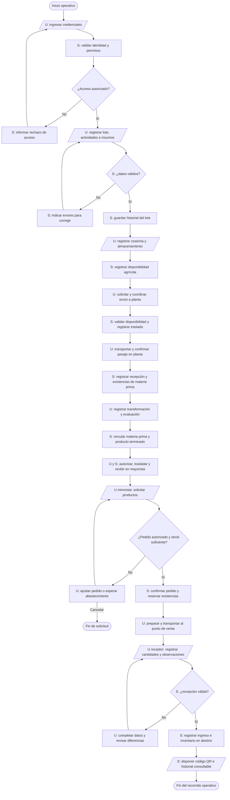
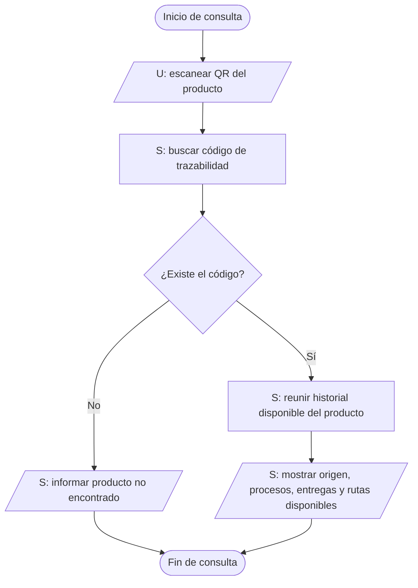

# Propuesta integral de AgroFusion

**Sistema de trazabilidad agrícola del campo al punto de venta**  
**Asignatura:** Proyecto de Sistemas III  
**Entrega:** modelo de negocio y diagramas de flujo

Esta propuesta permite al equipo y al docente evaluar cómo AgroFusion genera valor y cómo circula la información entre productores, planta, transportistas, mayoristas, minoristas y consumidores. El recorrido principal comprende producción agrícola, transformación en planta, distribución y consulta del origen mediante un código QR.

El documento plantea el funcionamiento y la sostenibilidad del sistema. Las fuentes de ingresos, las metas de adopción y los beneficios son hipótesis de la propuesta que requieren validación con usuarios. La revisión del repositorio respalda el alcance funcional descrito, pero no demuestra resultados de una operación real.

## 1. Problema identificado

La propuesta aborda la dispersión de la información agrícola y logística entre cuadernos, hojas de cálculo y mensajes. Cuando cada participante conserva registros separados, resulta difícil reconstruir de qué lote procede un producto, qué insumos se utilizaron, cómo se procesó, quién lo transportó y dónde se recibió.

Esta desconexión puede ocasionar diferencias de inventario, demoras para atender pedidos, duplicación de registros y dificultades para identificar los productos relacionados con una incidencia. El consumidor también dispone de poca información para conocer el recorrido del alimento. Estos problemas constituyen el diagnóstico inicial que el equipo debe contrastar con entrevistas y observación de los procesos.

## 2. Propuesta de valor

**AgroFusion conecta el historial del producto desde su lote agrícola hasta el punto de venta para que cada participante registre su intervención, consulte la información que le corresponde y pueda reconstruir el recorrido mediante un código QR.**

El valor se concreta en cuatro capacidades:

- Relacionar actividades, insumos y cosechas con su lote de origen.
- Registrar existencias, movimientos, procesos de planta y recepciones en una misma plataforma.
- Coordinar pedidos y traslados con responsables, fechas y estados identificables.
- Ofrecer una consulta pública del historial disponible mediante QR.

La utilidad de la trazabilidad depende de la calidad y continuidad de los registros. Un QR facilita la consulta de la información registrada; por sí solo no acredita la inocuidad ni sustituye una certificación.

## 3. Modelo de negocio

Se propone un modelo de servicio para organizaciones de la cadena agrícola. Los nueve bloques del modelo se presentan en la siguiente tabla:

| Bloque | Propuesta para AgroFusion |
|---|---|
| Segmentos de clientes | Asociaciones de productores, cooperativas, plantas procesadoras, distribuidores y organizaciones que coordinan varios eslabones de la cadena. Son los posibles contratantes del servicio. |
| Propuesta de valor | Historial vinculado del producto, control de inventarios por ubicación, coordinación de pedidos y entregas, y consulta del origen mediante QR. |
| Canales | Plataforma web para la operación; aplicación móvil como canal complementario según las funciones habilitadas; QR para consulta pública; demostraciones y pilotos con organizaciones agrícolas. |
| Relación con clientes | Acompañamiento en la configuración inicial, capacitación por funciones, soporte y seguimiento durante la adopción. |
| Fuentes de ingresos propuestas | Suscripción por organización, ajustada al alcance contratado, y cobro opcional por implementación, capacitación o soporte adicional. Las tarifas y la disposición a pagar deben validarse antes de comercializar. |
| Actividades clave | Mantener la plataforma, incorporar organizaciones, capacitar usuarios, preservar los vínculos de trazabilidad, respaldar información y atender incidencias. |
| Recursos clave | Equipo de desarrollo y soporte, conocimiento de los procesos agrícolas, servidor, base de datos, conectividad, dispositivos y registros aportados por los participantes. |
| Socios clave propuestos | Organizaciones productoras, plantas, operadores logísticos, mayoristas y comercios participantes; proveedores de alojamiento y servicios de mapas; entidades de certificación cuando corresponda. |
| Estructura de costos | Desarrollo, mantenimiento, alojamiento, almacenamiento de evidencias, copias de seguridad, servicios externos, capacitación y soporte. |

La sostenibilidad depende de que el ahorro operativo y el valor de la información justifiquen el costo del servicio para la organización contratante. El modelo no presupone comisiones por cada venta agrícola ni ingresos ya obtenidos.

## 4. Usuarios, clientes beneficiados y actores

Un cliente contratante puede agrupar a varios usuarios. Los consumidores son beneficiarios de la consulta pública, aunque no contraten el sistema. Las responsabilidades se distribuyen de la siguiente manera:

| Actor | Participación principal | Beneficio esperado |
|---|---|---|
| Administrador de la plataforma | Gestiona cuentas, permisos y catálogos, y supervisa la operación. | Mayor control del acceso y de la configuración. |
| Productor y responsable agrícola | Registran lotes, actividades, uso de insumos y cosechas según sus permisos. | Historial organizado de la producción. |
| Operario y responsable de planta | Registran recepción, pesaje, transformación, evaluación y producto terminado según sus permisos. | Relación entre materia prima y producto obtenido. |
| Transportista | Registra la ejecución del traslado, llegada y evidencias de entrega que correspondan. | Claridad sobre la carga, el destino y la entrega. |
| Mayorista y responsable de almacén | Gestionan existencias, pedidos, preparación de envíos y recepción de productos. | Mejor coordinación entre disponibilidad y demanda. |
| Minorista o encargado del punto de venta | Solicita productos, confirma recepción y consulta inventario y QR. | Información sobre el abastecimiento y el origen del producto. |
| Consumidor | Escanea el QR y consulta el historial público disponible sin iniciar sesión. | Mayor acceso a información sobre procedencia y recorrido. |
| Auditor o entidad certificadora | Revisa evidencias o aporta documentación cuando participa en el proceso. El acceso interno requiere autorización. | Información organizada para apoyar la revisión. |

El nombre del actor describe su función de negocio. Los permisos efectivos determinan qué acciones puede ejecutar cada cuenta.

## 5. Recursos necesarios

Los recursos que sostienen la operación son los siguientes:

| Tipo | Recursos necesarios |
|---|---|
| Humanos | Representante de la organización, responsables de cada etapa, usuarios capacitados y equipo de mantenimiento y soporte. |
| Tecnológicos | Aplicación web, servidor, base de datos, almacenamiento de documentos o fotografías, conexión a internet y equipos con navegador. Teléfonos para consulta móvil y lectura de QR. |
| Operativos | Identificación consistente de lotes y productos, unidades de medida, catálogos, pesaje de recepciones y procedimientos para registrar entregas y diferencias. |
| De información | Datos de usuarios, cultivos, lotes, insumos, cosechas, almacenes, procesos, pedidos, vehículos, destinos y evidencias disponibles. |
| Económicos | Presupuesto para desarrollo, operación, respaldo, capacitación y soporte. |

## 6. Entradas de información

Las entradas se organizan por su origen y uso dentro del sistema:

| Entrada | Quién la proporciona | Uso principal |
|---|---|---|
| Credenciales y datos de cuenta | Usuario; administrador para autorizaciones | Comprobar identidad y permisos. |
| Cultivo, ubicación, superficie, fechas y responsable del lote | Equipo agrícola | Identificar el origen de la producción. |
| Actividades, insumos, cantidades, fechas y evidencias | Equipo agrícola | Construir el historial de manejo del lote. |
| Cantidad cosechada y unidad de medida | Responsable agrícola | Registrar producción y disponibilidad. |
| Materias primas, operaciones, cantidades y evaluación de planta | Personal de planta | Relacionar entradas con producto terminado. |
| Productos, cantidades solicitadas y destino | Solicitante del pedido | Gestionar abastecimiento y disponibilidad. |
| Transportista, vehículo, origen, destino y datos de ruta | Responsable logístico y transportista | Coordinar y registrar el traslado. |
| Cantidades recibidas, observaciones y evidencias de entrega | Responsable receptor | Confirmar recepción y registrar diferencias. |
| Código de trazabilidad leído desde el QR | Consumidor o persona consultante | Recuperar el historial público asociado. |

## 7. Procesos principales y actividades

La secuencia distingue lo que registra o decide una persona de lo que realiza el sistema:

| Etapa | Actividad del usuario | Actividad del sistema | Salida principal |
|---|---|---|---|
| 1. Acceso | Introduce sus credenciales. | Verifica identidad, estado de cuenta y permisos. | Acceso autorizado o mensaje de rechazo. |
| 2. Registro agrícola | Registra lote, cultivo, actividades e insumos. | Valida datos y relaciona los registros con el lote y sus responsables. | Historial agrícola consultable. |
| 3. Cosecha | Registra cantidad, unidad y ubicación de almacenamiento. | Guarda la producción y su disponibilidad asociada. | Existencias agrícolas identificadas. |
| 4. Abastecimiento de planta | Solicita materia prima, coordina el transporte y confirma el pesaje recibido. | Verifica disponibilidad, registra el envío y acredita la recepción confirmada. | Ingreso de materia prima en planta. |
| 5. Transformación | Registra materias primas, pasos del proceso, resultados y evaluación. | Relaciona consumos con el lote de producción y registra producto terminado. | Historial de transformación y existencias de producto terminado. |
| 6. Abastecimiento mayorista | Solicita o coordina el traslado, autoriza la salida y confirma recepción según sus atribuciones. | Registra estados y movimientos entre planta y mayorista. | Existencias en el almacén mayorista. |
| 7. Pedido del minorista | Solicita productos; el mayorista revisa disponibilidad y acepta o rechaza. | Valida cantidades y disponibilidad; reserva existencias al confirmar el pedido. | Pedido confirmado o solicitud pendiente de ajuste. |
| 8. Distribución al punto de venta | Prepara la carga, ejecuta la entrega y confirma recepción. | Registra salida, traslado y entrada confirmada en destino. | Inventario actualizado y entrega registrada. |
| 9. Consulta de trazabilidad | Accede al QR del producto. | Busca el código y reúne el historial público disponible. | Procedencia, etapas, fechas y rutas cuando existen datos. |
| 10. Seguimiento de gestión | Consulta reportes y revisa diferencias. | Presenta información registrada de producción, inventario, actividades y distribución. | Reportes para apoyar decisiones. |

Una llegada del vehículo y una recepción de inventario son eventos distintos. En planta, el ingreso debe reflejar el pesaje confirmado por el receptor. Cada traslado conserva el vínculo con su origen y destino.

## 8. Decisiones relevantes

Las decisiones y sus alternativas determinan cómo continúa el flujo:

| Decisión | Si se cumple | Si no se cumple |
|---|---|---|
| ¿La cuenta está autorizada para la operación? | Permitir la acción. | Informar el motivo y detener la operación; permitir corregir el acceso. |
| ¿Los datos requeridos son válidos? | Guardar el registro. | Mostrar errores y devolver el formulario para corregirlo. |
| ¿Existe cantidad disponible para el movimiento? | Continuar con la preparación o confirmación. | Ajustar cantidades, esperar abastecimiento o cancelar la solicitud. |
| ¿El responsable autoriza el pedido o traslado? | Continuar con el despacho. | Registrar el rechazo o mantener la solicitud pendiente según su estado. |
| ¿La recepción cumple los requisitos de registro? | Guardar cantidades realmente recibidas y actualizar el destino. | Solicitar completar o corregir los datos de recepción. |
| ¿Hay diferencias o incidencias en la entrega? | Documentarlas y someterlas a revisión del responsable. | Continuar con la confirmación ordinaria. |
| ¿El código de trazabilidad existe? | Mostrar el historial disponible. | Informar que no se encuentra un producto asociado. |

Las diferencias entre cantidad enviada y recibida deben quedar documentadas. La decisión física de aceptar, devolver o descartar producto corresponde al responsable y al procedimiento de la organización; no se deduce únicamente del registro de llegada.

## 9. Diagrama de flujo operativo

**Leyenda:** U = actividad del usuario; S = actividad del sistema. Los rombos representan decisiones y las flechas indican el orden. Los controles de datos, disponibilidad, autorización y recepción se aplican a cada traslado, aunque el diagrama los agrupa para facilitar su lectura.

El recorrido representa las intervenciones de varios usuarios en sesiones distintas. Cada uno accede a su etapa con sus permisos. La consulta pública del QR tiene una entrada independiente y se presenta en el siguiente diagrama.

## 10. Diagrama de consulta pública

## 11. Salidas y flujo de la información

Las salidas principales son el historial del lote, los registros de producción y transformación, los inventarios por ubicación, los estados de pedidos y entregas, las incidencias documentadas, los reportes de gestión y la consulta pública mediante QR.

La información sigue esta secuencia lógica:

1. El lote identifica el origen agrícola y vincula actividades, insumos y cosechas.
2. La cosecha identifica la producción disponible y su ubicación de almacenamiento.
3. El pedido y el envío relacionan la salida agrícola con la recepción en planta.
4. El lote de producción vincula las materias primas utilizadas con el producto terminado. Si intervienen varios lotes, el registro debe conservar cada relación y cantidad.
5. Los traslados relacionan el producto con las existencias recibidas en mayorista y punto de venta.
6. El código del producto permite recuperar los eventos relacionados y construir la consulta pública.

Los identificadores de lotes, productos, pedidos y movimientos sostienen esas relaciones. El QR contiene un acceso a la consulta; el historial se obtiene de la información asociada en el sistema.

## 12. Beneficios esperados, resultados e impacto

Los beneficios son expectativas que deben comprobarse durante un piloto. Los indicadores propuestos permiten evaluar su cumplimiento:

| Beneficio esperado | Resultado observable | Indicador propuesto |
|---|---|---|
| Mejor continuidad de la trazabilidad | Productos con registros vinculados desde campo hasta punto de venta. | Productos del piloto con todas las etapas vinculadas / total de productos evaluados × 100. |
| Mayor control de inventario | Existencias registradas más cercanas al conteo físico. | Diferencia absoluta entre cantidad física y registrada, por producto, almacén y unidad. |
| Mayor rapidez para responder consultas | Menor tiempo para reconstruir el recorrido de un producto. | Tiempo mediano necesario para recuperar su historial antes y durante el piloto. |
| Mejor coordinación de entregas | Mayor cumplimiento de fechas acordadas. | Entregas recibidas dentro del plazo / entregas evaluadas × 100. |
| Mayor visibilidad de mermas | Diferencias de cantidad identificadas por etapa. | Cantidad de merma registrada / cantidad de entrada en la misma unidad × 100. |
| Adopción de registros digitales | Participantes que completan las actividades que les corresponden. | Registros obligatorios completados / registros esperados en el piloto × 100. |

El impacto económico esperado es reducir trabajo de conciliación y pérdidas asociadas a errores de información. El impacto organizativo es mejorar la coordinación y la identificación de responsabilidades. El impacto para el consumidor es facilitar el acceso a información sobre el origen. El registro de mermas puede apoyar un mejor uso de recursos, pero no permite afirmar una reducción ambiental sin mediciones.

Antes de fijar metas, el equipo debe obtener una línea base y acordar un piloto con productos y participantes definidos. No se presentan porcentajes de mejora ni ahorros como resultados ya alcanzados.

## 13. Alcance respaldado por el proyecto

La propuesta toma como referencia las siguientes fuentes locales:

- [Descripción de AgroFusion](../Web/README.md): alcance general de gestión agrícola, inventario, logística, planta y reportes.
- [Rutas web](../Web/routes/web.php): acceso público a trazabilidad y operaciones de lotes, planta, pedidos, traslados y recepciones.
- [Ámbitos de almacén](../Web/app/Support/AlmacenAmbito.php): agrícola, planta, mayorista y punto de venta.
- [Servicio de trazabilidad del producto](../Web/app/Support/TrazabilidadProductoPdvService.php): código, consulta pública y composición de eventos de la cadena.
- [Recepción en planta](../Web/app/Services/RecepcionPlantaEnvioService.php): registro del pesaje recibido y movimientos de ingreso.
- [Producción en planta](../Web/app/Services/LoteProduccionPlantaService.php): relación entre materias primas, consumos y lote de producción.
- [Reserva de pedidos](../Web/app/Services/PedidoDistribucionReservaService.php): disponibilidad y reserva para pedidos confirmados del mayorista.
- [Permisos por función](../Web/config/permission_matrix.php): autorización de acciones.
- [Alcance de Flutter](../Mobile/README.md): autenticación, perfil y navegación con consultas de módulos; no acredita que todas las operaciones web estén disponibles en móvil.

La existencia de estos componentes respalda la descripción del dominio. La integridad de la trazabilidad de cada producto requiere comprobar sus registros y relaciones; el servicio también contempla reconstrucciones inferidas. La propuesta no presenta la revisión del código como una certificación de información ni como una prueba del flujo completo en producción.

## 14. Correspondencia con la consigna

La siguiente tabla permite localizar los catorce puntos solicitados:

| Punto solicitado | Sección |
|---|---|
| Problema identificado | 1 |
| Propuesta de valor | 2 |
| Usuarios o clientes beneficiados | 3 y 4 |
| Actores involucrados | 4 |
| Actividades o procesos principales | 3 y 7 |
| Recursos necesarios | 5 |
| Beneficios esperados | 12 |
| Resultados e impacto de la solución | 12 |
| Entradas de información | 6 |
| Procesos principales del sistema | 7 |
| Actividades del usuario y del sistema | 7, 9 y 10 |
| Decisiones relevantes | 8, 9 y 10 |
| Salidas o resultados generados | 7 y 11 |
| Flujo lógico y secuencial de la información | 9, 10 y 11 |
